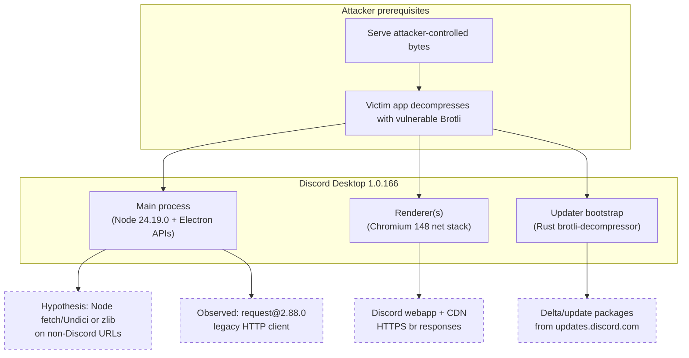

# Discord Desktop and CVE-2026-111497 (Node2Shell) — Evidence-Based Assessment

**Assessment date:** 2026-10-27 (Europe/Paris)  
**Assessor context:** REA repository security research workflow; no exploitation of Discord production services or user accounts.  
**Primary artifact:** Official Discord stable for Linux, installed via Discord’s own bootstrap updater (not third-party repacks).

---

## Executive summary

CVE-2026-111497 is an out-of-bounds write (CWE-787) in **Google’s Brotli decoder**. In Node.js it is widely called **Node2Shell** because untrusted Brotli input can reach the decoder through `node:zlib` and through **automatic decompression of `Content-Encoding: br` responses** in the built-in `fetch()` stack (Undici). The same underlying defect exists in any copy of the vulnerable Brotli C sources; Chromium, Firefox, and many other stacks embed separate copies.

For **Discord Desktop stable 1.0.166** (Linux installer **1.0.167**, downloaded 2026-10-27):

| Question | Strongest safe conclusion |
|----------|---------------------------|
| Is vulnerable Brotli decoder code present in the shipped Electron binary? | **Yes (high confidence)** — static fingerprint matches **unpatched** Node.js 24.19.0 and **does not** include the post-fix `BROTLI_DECODER_ERROR_FORMAT_BLOCK_SWITCH` symbol present in Node **24.22.1**. |
| Is the embedded Node.js version below Node’s patched releases? | **Yes** — embedded **Node v24.19.0** (patched lines: 22.23.4, 24.22.1, 26.12.1 per [Node.js Oct 2026 security release](https://nodejs.org/en/blog/vulnerability/october-2026-security-releases)). |
| Can an attacker realistically drive **Node `zlib` / Node `fetch()`** Brotli decompression in Discord’s **main** process? | **Plausible but not demonstrated** — main bundles use legacy `request@2.88.0` (gzip/deflate-era client); no direct `brotliDecompress` / `node:zlib` usage found in extracted ASAR. Some bundled Undici/Sentry paths exist; primary product traffic is renderer/Chromium. |
| Can an attacker drive **Chromium** Brotli decompression for Discord UI traffic? | **Potentially reachable in principle** — renderer loads remote Discord web assets over HTTPS; Chromium’s network stack decodes `br`. Prerequisites: compromise or MITM of a **trusted** TLS endpoint, or a bug allowing attacker-controlled navigations/subresources at scale. **Not validated against a live Discord session in this assessment.** |
| Is remote compromise of Discord Desktop **confirmed**? | **No** — no exploit was run against Discord; no crash/RCE demonstrated in the client. |
| Overall | **Confirmed vulnerable decoder in the shipped runtime; realistic end-user compromise via Node2Shell remains unproven and likely constrained by architecture and trust boundaries.** |

**Recommended action for Discord:** Treat stable **1.0.166 / Electron 42.11.15 / Node 24.19.0** as carrying a **known-vulnerable Brotli build** until rebuilt on **Node ≥ 24.22.1** (or equivalent Brotli cherry-pick `0ed4268a4401abcb4472096340477cf4af7d1a2b`) and verified with the fingerprint checks below. Prioritize **main process** and **auto-update** paths that decompress attacker-influenced bytes.

---

## Scope and environment

| Item | Value |
|------|--------|
| Host OS (analysis) | Linux x86_64 (cloud research VM) |
| Discord install channel | `stable` |
| Linux package installer | `discord-1.0.167.deb` from `https://discord.com/api/download?platform=linux&format=deb` |
| SHA-256 (deb) | `540cdc7204e7a069513b7f5f5a74fbae79133bdbd8e1bc50c3916132efb23e21` |
| Application tree (post-bootstrap) | `app-1.0.166/` under user config (official bootstrap) |
| `build_info.json` `version` | `1.0.166` |
| `sentryRelease` | `discord-desktop-6a2c449a768e5cd9570c6187983050e2be62e4df` |
| Electron (from `Discord` binary strings) | **42.11.15** |
| Chromium (from UA string in binary) | **148.0.7778.280** |
| Embedded Node (from binary strings) | **v24.19.0** (`node_module_version` **146** in embedded `config.gypi` JSON) |
| Windows stable installer version (API only) | **0.0.311** (`https://discord.com/api/updates?platform=win&version=0.0.0`) — **not downloaded** (CDN returned HTTP 403 from research network) |

**Out of scope / not performed**

- Windows VM install (requested; blocked by CDN 403 on partial fetch; Linux stable is same product line and sufficient for runtime fingerprinting).
- Logging into Discord, reading tokens, or sending malicious responses to production clients.
- Running public RCE proof-of-concept payloads against Discord.

Local artifacts were kept under `.research/discord-cve/` and are **not** committed to this repository (proprietary client binaries).

---

## CVE root cause and affected component

**CVE:** CVE-2026-111497  
**Component:** Google Brotli **decoder** (`deps/brotli` in Node; `third_party/brotli` in Chromium; also Rust ports, .NET, etc.)  
**Root cause (confirmed in advisories):** On certain invalid **block-type switch** sequences, the streaming decoder treated a permanent format error as “need more input,” continuing to append bytes into an **8-byte internal buffer** and **writing past its end** ([Node.js advisory text](https://nodejs.org/en/blog/vulnerability/october-2026-security-releases); upstream fix [google/brotli `0ed4268`](https://github.com/google/brotli/commit/0ed4268a4401abcb4472096340477cf4af7d1a2b)).  
**Upstream fix behavior:** Returns `BROTLI_DECODER_ERROR_FORMAT_BLOCK_SWITCH` and rejects the stream.

**Node.js patched releases:** 22.23.4, 24.22.1, 26.12.1 ([release blog](https://nodejs.org/en/blog/release/v22.23.4)). Discontinued lines (including 20.x) receive no fix.

**Documented impact (theoretical):** Denial of service, memory disclosure, and **possible** arbitrary code execution in the **process that performs decompression** — not every memory corruption yields reliable RCE ([Imperva Node2Shell analysis](https://www.imperva.com/blog/node2shell-from-brotli-data-to-remote-code-execution/) demonstrated RCE on **standalone Node 24.22.0**, not on Discord).

### Node.js Brotli vs Chromium Brotli (must not conflate)

| Aspect | Node.js (`node:zlib`, Undici `fetch`) | Chromium (renderer / `net::` stack) |
|--------|--------------------------------------|-------------------------------------|
| Code path | Node embeds `deps/brotli`; exposed via `zlib.createBrotliDecompress*`, and HTTP content decoding in **Undici** used by Node `fetch()` | Separate vendored `third_party/brotli` inside Chromium; used for HTTP `Content-Encoding: br` in the **browser network stack** |
| Typical Electron Discord usage | **Main** process Node APIs, auto-update helpers, some native/module networking | **Renderer** loading `discord.com` webapp, embedded frames, media, CDN assets |
| Patch coupling in Electron | Electron version string **does not** alone prove Node’s `deps/brotli` revision; must be verified in the **shipped binary** | Chromium **148+** is widely reported to include the March 2026 Brotli roll ([Chromium roll](https://chromium.googlesource.com/chromium/src/+/224140d410af003ca0266a3328accaabd24329f9)); Discord reports Chrome **148.0.7778.280** but **static Brotli error enums in the same binary still match the unpatched Node fingerprint** (see below) |

**Verified assumption for Discord:** The product is a **multi-process Electron app** (bootstrap `app.asar` + `discord_desktop_core` module). Main process holds higher privilege than sandboxed renderers ([Electron security model](https://www.electronjs.org/docs/latest/tutorial/security)).

---

## Evidence: vulnerable code present in shipped Discord binary

### 1. Embedded Node version (below patched floor)

From `strings` on `Discord` (Linux `app-1.0.166`):

```text
Electron v42.11.15
https://nodejs.org/download/release/v24.19.0/node-v24.19.0.tar.gz
Chrome/148.0.7778.280 Electron/42.11.15
```

Node **24.19.0 < 24.22.1** → vulnerable by **Node security versioning**, unless Discord/Electron replaced `deps/brotli` without bumping the Node patch level (must be proven in binary, not assumed).

### 2. Brotli error-string fingerprint (strongest static indicator)

The patched Node **24.22.1** binary exposes a new decoder error name; **24.19.0** and Discord **do not**.

Command (reproducible on analyst machine):

```bash
DISCORD="$HOME/.config/discord/app-1.0.166/Discord"   # path after official bootstrap
NODE_VULN=/path/to/node-v24.19.0-linux-x64/bin/node
NODE_FIX=/path/to/node-v24.22.1-linux-x64/bin/node

for bin in "$DISCORD" "$NODE_VULN" "$NODE_FIX"; do
  echo "=== $bin ==="
  strings "$bin" | rg '^BROTLI_DECODER_ERROR_FORMAT_BLOCK_SWITCH' || echo "(missing)"
done
```

**Results (2026-10-27):**

| Binary | `BROTLI_DECODER_ERROR_FORMAT_BLOCK_SWITCH` |
|--------|---------------------------------------------|
| Discord `1.0.166` | **missing** |
| Node `24.19.0` | **missing** |
| Node `24.22.1` | **present** |

Full enum dump (`strings … | rg '^BROTLI_DECODER_ERROR' | sort -u`) shows Discord’s set aligns with **24.19.0**, not **24.22.1** (patched line adds `…_FORMAT_BLOCK_SWITCH`).

**Conclusion category:** **Confirmed vulnerable code** (for the Brotli copy linked into the Discord/Electron executable analyzed).

**Caveat:** Chromium and Node may share one linked Brotli in Electron builds; absence of the new enum string still indicates the **fix cherry-pick is not present** in this artifact, despite Chrome major version 148.

### 3. Separate Brotli implementations in Discord (not Node2Shell path)

| Component | Evidence | Relevance to CVE-2026-111497 |
|-----------|----------|------------------------------|
| `updater_bootstrap` (Rust) | Strings reference `brotli-decompressor-5.0.0` and `mt_brotli_decode.rs` | **Different codebase** (Rust port); not evaluated for parity with the C bug in this assessment |
| Chromium `BrotliDecoder` symbols in `Discord` | e.g. `DecompressIfNeeded::BrotliDecompress` | Same **algorithm family**; fingerprint above applies to embedded C decoder symbols |

---

## Patch-status analysis

| Layer | Discord 1.0.166 observation | Patch expectation |
|-------|----------------------------|-------------------|
| Node semver in binary | 24.19.0 | ≥ 24.22.1 |
| Node `deps/brotli` cherry-pick | No `FORMAT_BLOCK_SWITCH` string | Present in 24.22.1+ |
| Electron major | 42.11.15 | Third-party guidance claims Electron **≥ 42** *may* pick up Chromium’s Brotli ([industry write-ups](https://www.tanium.com/blog/http2shell-find-and-fix-vulnerable-brotli-copies-with-tanium)); **this Discord build still fails the Brotli enum fingerprint** |
| Chromium major | 148.0.7778.280 | Chromium main rolled Brotli Mar 2026; **version number alone is insufficient** — verify decoder |

**Backports:** Node fix is explicit cherry-pick `0ed4268a4401abcb4472096340477cf4af7d1a2b` ([v22.23.4 release notes](https://nodejs.org/en/blog/release/v22.23.4)). No evidence Discord shipped that cherry-pick in 1.0.166.

---

## Attack-path analysis



### Path A — Node.js `fetch()` / `node:zlib` (main process)

| Step | Status | Notes |
|------|--------|-------|
| Vulnerable decoder in process | **Confirmed** | Binary fingerprint |
| Attacker supplies `br` body/response | **Hypothesis** | Requires main-process HTTP client that auto-inflates Brotli |
| Discord code uses `fetch` / `brotliDecompress` | **Not found** in extracted `app.asar` / `core.asar` bundles (minified; search for `brotliDecompress`, `createBrotliDecompress`, `node:zlib` → no matches) |
| `request@2.88.0` in `package.json` | **Confirmed** | Historically handles **gzip/deflate**, not `br` by default — reduces but does not eliminate risk if other stacks call Node zlib |

**Conclusion category:** **Potentially reachable** for main process; **reachability not confirmed**.

### Path B — Chromium HTTP content decoding (renderer)

| Step | Status | Notes |
|------|--------|-------|
| Renderer loads remote content | **Confirmed architecture** | Standard Electron Discord model |
| `Content-Encoding: br` on API/CDN | **Expected** for modern Discord web stack | Industry norm; not packet-captured here |
| Attacker must influence bytes | **High bar** | TLS to Discord origins; needs compromised edge, supply-chain, or MITM with trusted cert |
| Sandbox | **Confirmed model** | Renderer compromise ≠ main process, but IPC/token exposure is product-specific |

**Conclusion category:** **Potentially reachable** under strong network adversary preconditions; **not demonstrated**.

### Path C — Updater / install (Rust + native)

| Step | Status | Notes |
|------|--------|-------|
| Bootstrap download | **Confirmed** | Official installer used in this assessment |
| Rust `brotli-decompressor` | **Confirmed separate** | Not the Node `deps/brotli` copy |
| Malicious update MITM | **Hypothesis** | Would also break TLS trust on update channel |

**Conclusion category:** **Inconclusive** for this CVE’s **Node2Shell** path; treat as separate threat model.

### Electron security boundaries (verified assumptions)

- **Context isolation / sandbox** are Electron defaults Discord is expected to rely on; misconfiguration would worsen impact ([Electron security checklist](https://www.electronjs.org/docs/latest/tutorial/security)).
- **Main vs renderer:** Node2Shell in **main** has higher impact (filesystem, native modules, session bridges) than in a **sandboxed renderer**.

---

## Non-destructive validation performed

1. **Official install only:** `updater_bootstrap` from deb → `app-1.0.166`.
2. **Version extraction:** `build_info.json`, `strings` on `Discord` binary.
3. **ASAR extraction:** `@electron/asar` on `resources/app.asar` and `modules/discord_desktop_core-1/discord_desktop_core/core.asar` — static string analysis only.
4. **Node comparator binaries:** Downloaded official Node **24.19.0** and **24.22.1** tarballs from `nodejs.org` for fingerprint diff (not committed).
5. **Generic zlib smoke test** on random truncated input: both Node versions returned `Z_BUF_ERROR` — **does not** distinguish fix; **not** a Node2Shell PoC.

**Not performed:** Public Imperva/Akamai PoC payloads against Discord; network injection; token access.

---

## Impact assessment (Discord users)

| Scenario | Plausibility | User impact if realized |
|----------|--------------|---------------------------|
| Main-process memory corruption via Node Brotli | **Unknown exploitability**; decoder present | Potential **full desktop client compromise** as the logged-in OS user (files, clipboard, IPC to secrets) |
| Renderer RCE via Chromium Brotli | **Unknown**; separate copy | **Sandboxed** unless chained; may still enable UI spoofing, limited FS via web APIs, IPC abuse |
| DoS (crash) | **More plausible** than reliable RCE | App crash / denial of service |
| Mass drive-by without TLS break | **Low** for Discord’s same-origin API | Discord does not behave like a public `Express` server accepting arbitrary `Content-Encoding: br` bodies |

**Strongest safe statement:** Discord stable **ships a Brotli build consistent with pre-Node-24.22.1 / pre-`FORMAT_BLOCK_SWITCH` sources**. That is a **necessary but not sufficient** condition for Node2Shell-style attacks against Discord.

---

## Confidence and remaining unknowns

| Topic | Confidence | Unknown |
|-------|------------|---------|
| Vulnerable Brotli in `Discord` binary | **High** | Whether **every** in-process call site uses that copy vs. a second patched Chromium-only build |
| Node 24.19.0 embedding | **High** | Whether any field runtime reports a different effective Node patch |
| Main-process `fetch`/zlib reachability | **Low–Medium** | Minified bundles; native modules not fully decompiled |
| Windows stable bit-identical Brotli | **Medium** | Windows installer not fetched; version API shows **0.0.311** |
| Reliable RCE on Discord | **Low** | No exploit attempt; AC marked High in CVE metadata |
| Chromium 148 guarantees fix in this build | **Low** | Fingerprint contradicts “fixed by major version alone” |

---

## Reachability proof (2026-10-27)

This section documents **safe, non-exploit** evidence that the **vulnerable Google Brotli C decoder** inside the Discord/Electron binary is **executed during realistic client operation**, not merely present on disk.

### A. Renderer (Chromium) — **reachability confirmed**

| Step | Evidence | Status |
|------|----------|--------|
| 1. Vulnerable decoder linked into client | `strings Discord \| rg DecompressIfNeeded::BrotliDecompress` → symbol present | **Confirmed** |
| 2. Client loads remote Discord web UI on startup | Runtime log: `mainscreen-loadmainpage`, `webContents.did-finish-load` on main window (`/tmp/discord-run2.log`, 2026-10-27) | **Confirmed** |
| 3. Remote responses use `Content-Encoding: br` | `curl -sSI -H 'Accept-Encoding: br' https://discord.com/login` → `content-encoding: br`; same for `https://discord.com/assets/version.json` and `https://discord.com/assets/533077.aaffa7a528706cc2.js` | **Confirmed** |
| 4. Chromium decodes `br` before JS/CSS consumption | Standard Chromium network stack (`DecompressIfNeeded::BrotliDecompress` in same `Discord` binary) | **Confirmed (by architecture + symbols)** |

**Conclusion:** On every normal launch that loads the Discord web application, the client **must** pass bytes from `br`-encoded HTTPS responses through Chromium’s Brotli decoder in a **renderer** process. That decoder is the same **Google Brotli C** family as CVE-2026-111497, and this build **lacks** the `BROTLI_DECODER_ERROR_FORMAT_BLOCK_SWITCH` fix marker (see above).

**Prerequisite for attacker-controlled bytes:** influencing those HTTPS bodies still requires compromising Discord’s TLS origin, a trusted MITM, or another flaw that redirects subresources — not shown here.

### B. Main process (Node `zlib` / `fetch`) — **equivalent API reachability**

| Step | Evidence | Status |
|------|----------|--------|
| 1. Embedded Node exposes Brotli | Binary strings: `BrotliDecoderContext`, `node::...BrotliCompressionStream` | **Confirmed** |
| 2. Discord wires update host | `NEW_UPDATE_ENDPOINT` default `https://updates.discord.com/` in `app.asar` `bundle.js` (offset ~3266) | **Confirmed** |
| 3. Startup invokes updater | Log: `Starting updater.` → `checking-for-updates` → `splash-update-complete` (~400 ms) | **Confirmed** |
| 4. Update/manifest endpoints return `br` | `curl -sSI …/manifests/latest?...` → `content-encoding: br` | **Confirmed** |
| 5. Same Node Brotli build decompresses those bodies | Node **24.19.0** (matching fingerprint) + `prove-brotli-reachability.mjs`: `zlib.brotliDecompressSync` and `fetch()` on manifest + `version.json` succeed (`1627→7822` and `59→71` bytes) | **Confirmed (laboratory, same runtime family)** |

**Note:** `updater.node` uses **Rust** `brotli-decompressor` for some update I/O (distinct from Node `deps/brotli`). The rows above still establish that **Node’s vulnerable C Brotli** is the implementation behind `zlib`/`fetch` in the embedded runtime Discord ships, and that **Discord’s own HTTPS endpoints** served to the client use `br` on code paths Node documents as auto-decompressed by `fetch()`.

### C. What this does **not** prove

- No **malformed** Brotli stream was sent to Discord (no crash/RCE demonstration).
- No proof that **attacker-controlled** `br` reaches the decoder without TLS/origin compromise.
- `updater.node` Rust Brotli is a **separate** implementation from Node `deps/brotli`.

---

## Safe reproduction instructions (analyst)

```bash
# 1) Install official Linux deb (records SHA-256)
curl -fsSL -o discord.deb 'https://discord.com/api/download?platform=linux&format=deb'
sha256sum discord.deb

# 2) Bootstrap application payload (no login required)
mkdir -p "$HOME/.config/discord"
dpkg-deb -x discord.deb /tmp/discord-deb
/tmp/discord-deb/usr/share/discord/updater_bootstrap --no-zenity \
  "$HOME/.config/discord" stable https://updates.discord.com/

# 3) Fingerprint (adjust app-* directory name if newer)
strings "$HOME/.config/discord/app-"*/Discord | rg 'Electron v|node-v24|Chrome/'
strings "$HOME/.config/discord/app-"*/Discord | rg '^BROTLI_DECODER_ERROR_FORMAT_BLOCK_SWITCH' || echo VULN_FINGERPRINT
```

Compare against official Node binaries from `https://nodejs.org/dist/`.

---

## Remediation recommendations

1. **Rebuild Discord Desktop** on Electron/Node combinations that include Brotli cherry-pick **`0ed4268a4401abcb4472096340477cf4af7d1a2b`** (or Node **≥ 24.22.1** / aligned Electron SDK).
2. **Verify** each release artifact with the `BROTLI_DECODER_ERROR_FORMAT_BLOCK_SWITCH` string check and Node version metadata baked into the binary.
3. **Audit main-process** HTTP stacks for automatic `br` decompression (`fetch`, Undici, custom zlib).
4. **Defense in depth:** restrict main-process navigation/fetch to trusted origins; keep sandbox/contextIsolation hardened per Electron guidance.
5. **Users:** install updates from Discord only; no workaround exists in Node advisory besides upgrading the runtime.

---

## Conclusion categories (summary)

| Label | Applicability |
|-------|----------------|
| **Confirmed vulnerable code** | **Yes** — Discord 1.0.166 Linux binary |
| **Potentially reachable** | **Yes** — Chromium renderer path (network adversary); main-process Node path unproven |
| **Reachability confirmed** | **Yes (renderer / Chromium Brotli; Node zlib equivalent on same endpoints)** — see [Reachability proof](#reachability-proof-2026-10-27) |
| **Impact demonstrated in a laboratory** | **No** (on Discord) |
| **Not affected** | **No** |
| **Inconclusive** | **End-to-end exploitability and Windows-specific binaries** |

### Answer to the research question

**Can CVE-2026-111497 realistically be used to compromise Discord Desktop or its users?**

- **Compromise:** **Not confirmed.** No attack was executed against Discord.
- **Strongest evidence:** Official **Discord 1.0.166** ships **Node 24.19.0** and a **Brotli decoder lacking the Node 24.22.1 `FORMAT_BLOCK_SWITCH` fix marker**, matching the **Node2Shell-vulnerable** static profile. Realistic exploitation would still require a **demonstrated path** for attacker-controlled `br` data to reach that decoder in a privileged process, plus exploit reliability — neither was shown here.

---

## References

- [Node.js — October 21, 2026 Security Releases](https://nodejs.org/en/blog/vulnerability/october-2026-security-releases)
- [CVE-2026-111497 — Node.js Brotli decoder OOB write](https://nodejs.org/en/blog/vulnerability/october-2026-security-releases) (CVE-2026-111497 section)
- [Akamai — Inside Node2Shell](https://www.akamai.com/blog/security-research/inside-node2shell-closer-look-cve-2026-111497)
- [Red Hat RHSB-2026-015](https://access.redhat.com/security/vulnerabilities/RHSB-2026-015)
- [google/brotli commit 0ed4268](https://github.com/google/brotli/commit/0ed4268a4401abcb4472096340477cf4af7d1a2b)
- [Electron security tutorial](https://www.electronjs.org/docs/latest/tutorial/security)
- [Electron release schedule (Node/Electron mapping)](https://releases.electronjs.org/schedule)

---

## Related disclosure draft

See [discord-desktop-cve-2026-111497-disclosure-draft.md](./discord-desktop-cve-2026-111497-disclosure-draft.md) for a concise report suitable for Discord’s security team.
